# NJIIS ASR / LHD Audit — Detailed SOP Knowledge Base

> **Source:** `SOP for ASR-Audit Problems(6).docx` (NJDOH staff SOP, supplied by the user).  
> **Purpose:** Detailed, searchable Markdown extraction of the SOP for staff troubleshooting and Microsoft Copilot knowledge.  
> **Scope:** All 17 distinct embedded screenshots have been reviewed; image descriptions are included.  
> **Fidelity:** Original SOP wording is reproduced in labeled `text` blocks. Staff-oriented interpretations are clearly identified separately. No NJIIS administrative procedure has been added where the SOP does not provide it.

## How to use this reference

1. Match each ticket to a category in the **Ticket routing index**.
2. Read the corresponding SOP procedure and identify what is already done versus what needs to happen next.
3. Use **Staff workflow (interpreted)** for the internal action list, checking the original SOP wording and screenshots.
4. Send the original **Approved SOP wording** only when the scenario fits, necessary administrative steps are verified complete, and its information is still current.
5. If the SOP does not document the missing action, label it **Needs further review**; do not improvise administrator steps or assume a change was made.

**Provenance convention:** `Source` = directly from SOP text; `Screenshot interpretation` = description of what a source screenshot visibly shows; `Staff workflow (interpreted)` = organization of source steps into an internal checklist (not an additional SOP policy).

**Page references:** Page numbers below follow the document's original table of contents where available. The original file includes screenshots and page breaks, so displayed pages may differ in other software.

## Ticket routing index

| Ticket issue / symptom | SOP category | SOP section | TOC page | Key next action |
|---|---|---|---:|---|
| School not enrolled | School enrollment | SCHOOL NEEDS ENROLLMENT | 3 | Direct school to enrollment and include intended user on form |
| Error about missing facility subtype | School subtype | SCHOOL SUBTYPE NEEDED | 3 | Ask whether Charter, Public, or Private; update after confirmation |
| School user needs ASR instruction or authorization | ASR training | NEEDS TRAINING — ASR TRAINING | 4 | Locate ASR on-demand training; allow stated activation period |
| LHD user needs Audit training | LHD training | NEEDS TRAINING — LHD TRAINING | 4 | Locate LHD Audit training; follow up after 2 business days if no privilege email |
| User needs NJIIS account and ASR training | New account + training | PERSON NEEDS NEW USER ACCOUNT AND TAKE THE ASR TRAINING | 5 | Collect six specified fields and refer to training |
| Training done, school access reportedly activated | Account / school access | ACCESS PROBLEMS — COMPLETED TRAINING AND NEED ACCESS TO SCHOOL | 6 | Confirm access has actually been activated; advise cache/browser retry |
| School Forms tab missing | Missing navigation tab | ACCESS PROBLEMS — IF THE PERSON HAS TAKEN THE TRAINING BUT CANNOT FIND THE SCHOOL FORMS TAB | 6 | Show user left navigation location, ask if visible |
| LHD receives access denied on Audit | LHD facility selection | LHD Emails — LHDS GETTING ACCESS DENIED AT THE SCHOOL REPORT; MISC QUESTIONS — LHD GET ACCESS DENIED | 7, 14 | Switch Current Facility to the school; use search if many facilities |
| User needs complete enrollment / training process | General process | FULL SUMMARY OF SCHOOL ENROLLMENT & ASR TRAINING PROCESS | 8 | Explain school enrollment, users/contacts, training, original deadline |
| User requests instructions / help guide | User guide | LINKING THE USER GUIDE | 8 | Share linked ASR/Audit guide |
| User needs a copy of ASR/Audit | Export / print form | SAVING COPY OF ASR/AUDIT FORM | 8 onward | Open applicable forms, Print → Save as PDF |
| Webinar black screen or jumps to end | Webinar technical issue | REPLY TO USERS WHO CAN ACCESS TRAINING... | 12 | Clear cached files, retry, switch browser, consult IT allowlisting |
| NJIIS account has been created | Account creation confirmation | CREATED NEW ACCOUNT | 14 | Only after creation: inform user to look for password-setup email |
| New user information required | New account request | CREATE NEW USER | 15 | Request six fields |
| School asks whether ASR data were received | Submission verification | CONFIRMING RECEIPT OF DATA | 16 onward | Search facility, inspect Audit report and grade-level data |

**Multiple issues in one ticket:** Apply all relevant SOP sections. These are routing categories for staff use, not a classification scheme written in the SOP.

## 1. SOP FOR ANSWERING EMAILS

**Source section:** `SOP FOR ANSWERING EMAILS` (TOC page 1).

### Source instructions (in original order)

**Source wording (original text):**

```text
Once you start correspondence with a person, please do your best to work with them through the resolution of their problem—this is to help ensure continuity and avoid people falling through the cracks.
Close the loop first
If you’ve been working with someone, close the loop before answering other messages
Once a call/email has been made (regardless of whether you’ve spoken to/interacted w/ the person), mark email as complete w/ check mark.
After closing the loop on any open user issues, answer emails that have been sitting the longest in the mailbox with the most emails
Once a call/email has been made (regardless of whether you’ve spoken to/interacted w/ the person), mark email as complete w/ check mark and put the email back in the shared Inbox.
Move the email to the “Completed” folder.
```

### Staff workflow (interpreted)

1. Maintain continuity: if you begin helping a person, try to remain involved through resolution.
2. Finish follow-up on existing open conversations before starting other tickets.
3. Mark the message complete with Outlook's check mark after a call or email has been made, as the SOP directs; this check mark refers to a **contact/action** and is not necessarily proof the underlying technical issue was fixed.
4. After existing cases, process the oldest outstanding messages in the mailbox with the most emails.
5. The SOP also mentions putting messages back in the shared Inbox and moving them to a `Completed` folder. This sequence is not fully reconciled in the document; follow the current approved team workflow for folder movement.

**Screenshot interpretation:** The first image shows Microsoft Outlook's follow-up menu with `Mark Complete` framed in red. The second shows an Outlook folder tree with `Completed` highlighted in red.

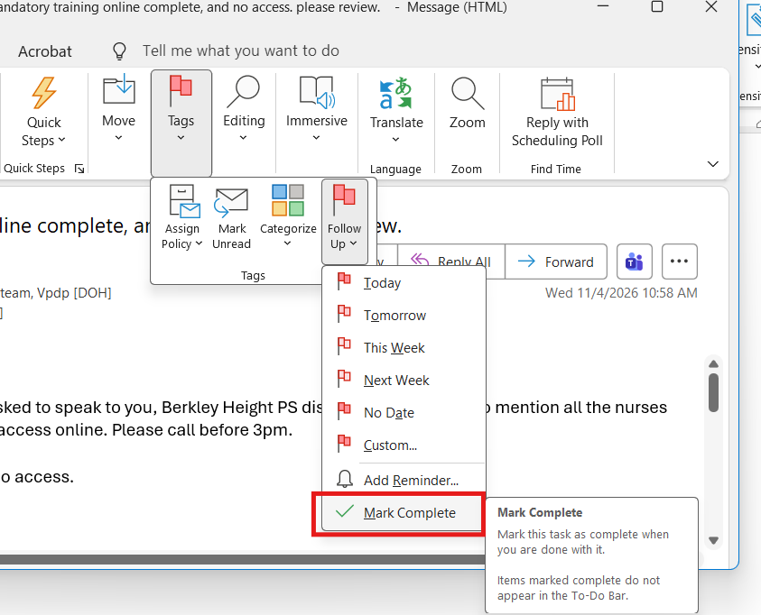

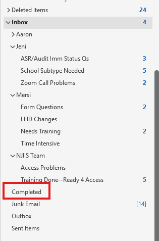

## 2. SCHOOL NEEDS ENROLLMENT

**Category:** School enrollment  
**Source section:** `SCHOOL NEEDS ENROLLMENT` (TOC page 3).  
**Trigger:** The school is not yet enrolled in NJIIS, or the sender asks where to enroll.

### Staff workflow (interpreted)

1. Determine that school enrollment is the question.
2. Give the NJIIS enrollment URL: https://njiis.nj.gov/core/web/index.html#/home/newEnrollment
3. Explain that only fields marked by a red asterisk (`*`) are required, according to the SOP.
4. Remind the sender to add their account information as a **user** on the form so the account can be assigned to that school.
5. Offer the enrollment FAQ: https://njiis.nj.gov/docs/schoolForms/NJIISSchoolReportFAQs.pdf
6. Ask whether the sender needs further help. The SOP gives no internal administrator procedure for approving the enrollment.

### Original SOP language

**Approved SOP wording (original text):**

```text
Please enroll your school in NJIIS through here https://njiis.nj.gov/core/web/index.html#/home/newEnrollment
Please note that only information needed is those with red asterisk (*).  Make sure to add your user account information as a user in the form so they can assign you to this school.
You can view our FAQ, which can help you complete the enrollment form, through here https://njiis.nj.gov/docs/schoolForms/NJIISSchoolReportFAQs.pdf
Let me know if you have further questions.
Thank you,
```

**Source links:** [School enrollment](https://njiis.nj.gov/core/web/index.html#/home/newEnrollment) · [School report FAQ (PDF)](https://njiis.nj.gov/docs/schoolForms/NJIISSchoolReportFAQs.pdf)

## 3. SCHOOL SUBTYPE NEEDED

**Category:** School subtype  
**Source section:** `SCHOOL SUBTYPE NEEDED`, including `SUBJECT: School Subtype Error` and `REPLY ONCE RECEIVING SUBTYPE` (TOC page 3).  
**Trigger:** The school is missing a subtype, or the case is described as a school subtype error.

### Staff workflow (interpreted)

1. Identify the school and the missing-subtype concern.
2. Ask the school to confirm one of the SOP's choices: **Charter, Public, or Private**.
3. After receiving the subtype, an authorized staff member updates NJIIS. **The SOP does not show the administrator screens or exact editing steps.**
4. Only after confirming that the NJIIS change was made, tell the user to sign back in and retry.
5. Ask the sender to report any further problem.

**Do not infer the subtype from the school name alone. Do not send the “I have updated NJIIS” response until the change is confirmed.**

### Initial user response — original SOP language

**Approved SOP wording (original text):**

```text
Hello,
It seems your school is missing the subtype. Can you let me know whether your school is Charter, Public, or Private? Once I get that info, I will update NJIIS and you should be able to complete your ASR after that point.
Thanks.
```

### After subtype update — original SOP language

**Approved SOP wording (original text):**

```text
Hi,
Thanks for the information. I have updated NJIIS. Please log back in and try again.
Please let me know if you have any other problems.
Thanks.
```

## 4. NEEDS TRAINING — ASR TRAINING

**Category:** ASR training  
**Source section:** `NEEDS TRAINING` → `ASR TRAINING` (TOC page 4).  
**Trigger:** A school user asks about required ASR training or when access will be activated.

### Staff workflow (interpreted)

1. Ask whether the sender has completed ASR training.
2. Give the [NJIIS Training Opportunities](https://njiis.nj.gov/core/web/index.html#/home/training) page.
3. Direct the sender to the table named **NJIIS Training Access to On-Demand Webinar Recordings**.
4. Direct them to **Annual Immunization Status Report (ASR) Training** and the **View** control.
5. Explain the SOP's activation expectation: **a couple of days after training completion**. The SOP does not specify a fixed activation guarantee for ASR training.
6. Ask whether further assistance is needed.

### Original SOP language

**Approved SOP wording (original text):**

```text
Have you completed the ASR training? Once the training is completed, please expect to wait a couple of days for your user account to be activated.
To register to the Annual Immunization Report (ASR) training, please go to the NJIIS Training Opportunities (https://njiis.nj.gov/core/web/index.html#/home/training), find the NJIIS Training Access to On-Demand Webinar Recordings table, and enroll into the Annual Immunization Status Report (ASR) Training by clicking “View.”
This training will walk you through the new ASR.
Let me know if you have further questions.
Thank you,
```

## 5. NEEDS TRAINING — LHD TRAINING

**Category:** LHD Audit training  
**Source section:** `NEEDS TRAINING` → `LHD TRAINING` (TOC page 4).  
**Trigger:** Local Health Department staff need access to the Audit form or ask about mandatory training.

### Staff workflow (interpreted)

1. Ask whether the sender has completed the Audit training.
2. Open [NJIIS Training Opportunities](https://njiis.nj.gov/core/web/index.html#/home/training).
3. Find **NJIIS Training Access to On-Demand Webinar Recordings**.
4. Select **Local Health Dept Immunization Audit Training** using **View**.
5. Explain that the SOP describes a couple-of-days activation wait.
6. The SOP asks the person to follow up if they do not receive confirmation of new privileges **after 2 business days**.

### Original SOP language

**Approved SOP wording (original text):**

```text
Have you completed the Audit training? Once the training is completed, please expect to wait a couple of days for your user account to be activated.
To register to the Local Health Dept Immunization Audit Training, please go to the NJIIS Training Opportunities (https://njiis.nj.gov/core/web/index.html#/home/training), find the NJIIS Training Access to On-Demand Webinar Recordings table, and enroll into the Local Health Dept Immunization Audit Training by clicking “View.”
This training will walk you through the new Audit form.
If you do not receive an email from me confirming the new privileges after 2 business days, please reach out to me.
Let me know if you have further questions.
Thank you,
```

## 6. PERSON NEEDS NEW USER ACCOUNT AND TAKE THE ASR TRAINING

**Category:** New NJIIS account + ASR training  
**Source section:** `PERSON NEEDS NEW USER ACCOUNT AND TAKE THE ASR TRAINING` (TOC page 5).  
**Trigger:** A new school user needs both an NJIIS account and ASR access.

### Staff workflow (interpreted)

1. Ask the sender for **all six source-requested fields** below.
2. Instruct the sender to complete the ASR training as described in the SOP.
3. Explain that activation may take a couple of days after training.
4. The SOP says staff can create an account, but **does not document the administrator procedure for account creation**.
5. Do not claim account creation is complete until confirmed.

### Required fields from the SOP

| Field | Exact label in the source |
|---|---|
| First name | `First Name:` |
| Last name | `Last Name:` |
| Email address | `Email:` |
| Work telephone | `Work Phone:` |
| School name | `Name of the school:` |
| ASR training date | `Date of ASR training:` |

### Original SOP language

**Approved SOP wording (original text):**

```text
I can create an account for you. Please provide me with the following information to create your account:
First Name:
Last Name:
Email:
Work Phone:
Name of the school:
Date of ASR training:
Please also take the ASR Training course to activate your account. Once the training is completed, please expect to wait a couple of days for your user account to be activated.
To register to the Annual Immunization Report (ASR) training, please go to the NJIIS Training Opportunities (https://njiis.nj.gov/core/web/index.html#/home/training), find the NJIIS Training Access to On-Demand Webinar Recordings table, and enroll into the Annual Immunization Status Report (ASR) Training by clicking “View.”
This training will walk you through the new ASR.
Let me know if you have further questions.
Thank you,
```

## 7. ACCESS PROBLEMS — COMPLETED TRAINING AND NEED ACCESS TO SCHOOL

**Category:** School access / account activation  
**Source section:** `ACCESS PROBLEMS` → `COMPLETED TRAINING AND NEED ACCESS TO SCHOOL` (TOC page 6).  
**Trigger:** Training is finished, the user needs the School Forms module or ASR, and staff have activated the account.

### Staff workflow (interpreted)

1. Verify that account activation/access really occurred before using the source's past-tense confirmation.
2. Replace the literal `SCHOOL` placeholder with the verified school name, if sending the message.
3. If difficulties remain, the source tells the user to clear browser cache, close the browser, reopen it, and access NJIIS again.
4. The SOP does not provide the detailed screen path for granting a school role.

### Original SOP language

**Approved SOP wording (original text):**

```text
Your account has been activated, and you should now have access to the School Forms module and ASR for SCHOOL.
If you are still having problems, please try the following:
Clear browser cache
Close browser
Open browser
Access NJIIS
```

## 8. ACCESS PROBLEMS — SCHOOL FORMS TAB NOT VISIBLE

**Category:** Missing School Forms navigation  
**Source section:** `IF THE PERSON HAS TAKEN THE TRAINING BUT CANNOT FIND THE SCHOOL FORMS TAB` (TOC page 6).  
**Trigger:** User reports that School Forms is absent or cannot be located after training.

### Staff workflow (interpreted)

1. Explain that `School Forms` is on the left navigation pane in the documented screen.
2. Ask the sender to check whether the row is displayed.
3. Use the original screenshot to show the location.
4. Ask the sender to confirm whether they can see it. The SOP does not say exactly how to fix a missing permission if the tab truly is absent.

### Original SOP language

**Approved SOP wording (original text):**

```text
I received a message about difficulty finding the School Forms tab in your NJIIS account. The tab is located on the left side of your screen and looks like the screenshot below. Are you able to see that? Please advise. Thanks.
```

**Screenshot interpretation — image3.png:** The NJIIS left sidebar displays modules including `NJIIS Enrollment`, `COVID`, `Monkeypox`, `School Forms`, `User`, and `Facility`. A red box identifies the `School Forms` row and its dropdown arrow; it is **not** at the top of the homepage or inside an email.

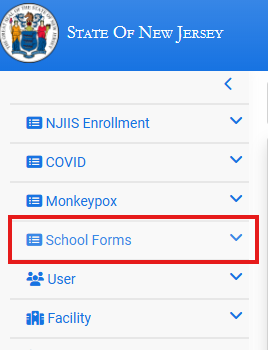

## 9. LHD ACCESS DENIED — SCHOOL FACILITY SELECTION

**Category:** LHD Audit access denied  
**Source sections:** `LHD Emails` → `LHDS GETTING ACCESS DENIED AT THE SCHOOL REPORT` (TOC page 7), and `MISC QUESTIONS` → `LHD GET ACCESS DENIED` (TOC page 14).  
**Trigger:** An LHD user reports “Access Denied” when opening a school report or Audit form.

### Staff workflow (interpreted)

1. On the NJIIS home page, ask the user to identify the **Current Facility** selection.
2. Tell the user to change the main/current facility to the relevant **school**, rather than leaving another facility selected.
3. After choosing the school, open the Audit form.
4. If the person has **more than 20 facilities**, the SOP says a facility search should appear.
5. The facility-search screenshot shows the available search fields and a result list. If the user can access this search, the SOP invites them to report that so staff can provide/check the facilities in the user account.
6. Refer to the ASR/Audit user guide, **page 22 as specified in the SOP**.
7. If the desired school is not available, the SOP does not give an administrator workflow for granting access; escalate for the appropriate account/facility review.

### Original SOP language — first LHD access-denied section

**Approved SOP wording (original text):**

```text
Please make sure to change the main facility to the school on the homepage before going to the audit form.
You can see our user guide here (Pg 22).
Please let me know if you have any questions.
Thank you,
```

### Original SOP language — second LHD access-denied section

**Approved SOP wording (original text):**

```text
On the dropdown, make sure to change to a school. You can see the list on the drop down.
If there are more than 20 facilities, it should show as a search:
If you do get this, please let me know and I can give you the facilities in your user account so you can check that way.
Thank you,
```

**Embedded hyperlink behind the words “here” in the SOP:** [ASR and Audit User Guide (PDF)](https://njiis.nj.gov/docs/schoolForms/ASRandAuditUserGuide.pdf).

**Screenshot interpretation — image10.png:** The NJIIS `Current Facility` dropdown opens a `Search Facility` interface, showing fields `Facility Name`, `Facility Id`, and `VFC Pin`, along with `Search`, `Reset`, and `Close` buttons. It demonstrates the search interface used when many facilities are associated with the account. The facility shown is sample data, not a facility the SOP tells staff to select.

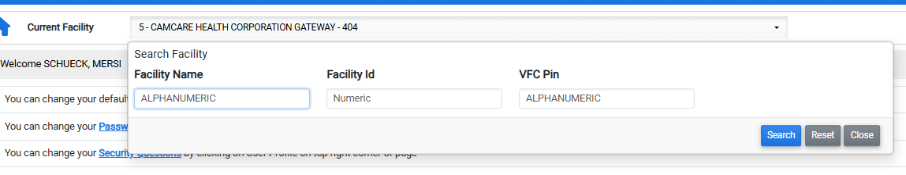

## 10. FULL SUMMARY OF SCHOOL ENROLLMENT & ASR TRAINING PROCESS

**Category:** General enrollment / ASR process  
**Source section:** `MISC QUESTIONS` → `FULL SUMMARY OF SCHOOL ENROLLMENT & ASR TRAINING PROCESS` (TOC page 8).  
**Trigger:** User asks how to begin using the new ASR process.

### Staff workflow (interpreted)

1. Explain that the SOP describes the ASR as available through NJIIS.
2. Enroll the school via the published NJIIS enrollment URL.
3. On the enrollment form, include all persons who need to view or edit the ASR **as contacts or users**, per this source section.
4. Have each intended ASR user complete on-demand training.
5. The source lists **December 1, 2026 at 11:59 PM** as the deadline. This is a dated SOP fact, not a permanent rule; verify applicability before using it in a later season.

**Source wording nuance:** The standalone `SCHOOL NEEDS ENROLLMENT` section specifically says to include account information **as a user**, while this general summary says **as contacts or users**. Preserve this distinction; do not silently harmonize it.

### Original SOP language

**Approved SOP wording (original text):**

```text
The reporting process has changed. The Annual Immunization Status Report (ASR) is now only available on the New Jersey Immunization Information System (NJIIS). To get access to the form, a school must enroll in NJIIS, all people who wish to view or edit the ASR should be included on the enrollment form, and those individuals must also complete the on-demand ASR training. Please see the process below to access the enrollment form and training.
Here is the process:
Enroll school in NJIIS using this link https://njiis.nj.gov/core/web/index.html#/home/newEnrollment
On the enrollment form, please include as either contacts or users anyone who you want to have access to either view or edit the Annual Immunization Status Report (ASR)
All people who want to view/edit the ASR must complete the on-demand ASR training, which is available here: https://register.gotowebinar.com/register/1147500267204169557
Please submit the ASR by the deadline: Dec 1, 2026 at 11:59 PM
```

## 11. LINKING THE USER GUIDE

**Category:** General help / reference  
**Source section:** `MISC QUESTIONS` → `LINKING THE USER GUIDE` (TOC page 8).  
**Trigger:** User requests detailed instructions for the ASR/Audit form.

### Staff workflow (interpreted)

1. Give the user the [ASR and Audit User Guide (PDF)](https://njiis.nj.gov/docs/schoolForms/ASRandAuditUserGuide.pdf).
2. Invite follow-up if the user cannot find the information in the guide.

### Original SOP language

**Approved SOP wording (original text):**

```text
We have created a user guide to help through the form. You can view it here. If you have any questions and you are not able to find them in the user guide, please do not hesitate to email me.
Please let me know if you have any questions.
Thank you,
```

**Extracted document hyperlink:** The word `here` links to `https://njiis.nj.gov/docs/schoolForms/ASRandAuditUserGuide.pdf`.

## 12. SAVING COPY OF ASR/AUDIT FORM

**Category:** Saving / printing the form  
**Source section:** `MISC QUESTIONS` → `SAVING COPY OF ASR/AUDIT FORM` (TOC page 8 onward).  
**Trigger:** User wants a PDF copy of the ASR or Audit form.

### Staff workflow (interpreted from text and screenshots)

1. In NJIIS, open the ASR form.
2. Select **Yes** for `Does the school have applicable grades or transfer students?`.
3. Answer `What grade levels are housed in your facility?` by selecting applicable grades.
4. Expand/open the ASR form for each selected grade so its grade-specific table is visible.
5. Click the **left-pointing arrow** near the top of the left navigation menu to collapse the menu; the original screenshot highlights this arrow.
6. In the central form area, **right-click** to open the browser's context menu.
7. Choose **Print**.
8. In the browser's print dialog, under **Destination**, select **Save as PDF**.
9. Click **Save** to save the generated PDF.

**Scope note:** This procedure is titled “ASR/AUDIT FORM” in the SOP, but its written step-by-step example specifically starts within the **ASR form**. Do not assume there are additional Audit-only steps not shown.

### Original SOP language

**Approved SOP wording (original text):**

```text
While in your ASR form on NJIIS, do the following:
Select Yes to the question “Does the school have applicable grades or transfer students?”
Select the applicable grades by answering the question: “What grade levels are housed in your facility?”
Open up the ASR form for each grade selected so that you see the tables w/ blank boxes for each grade.
Click the left arrow at the top of the menu on the left to hide that menu.
Move your cursor to the middle of the screen, right click your mouse so that the menu shown below appears on your screen (or something similar if you’re not using Google Chrome)
Click “Print”
After selecting “Print” a window will pop up.
In “Destination” select “Save as PDF”
Then click “Save”
Does this give you what you need? Thanks.
```

**Screenshot interpretation — image4.png:** The NJIIS form is open. A small red rectangle marks the **left arrow** at the top of the navigation sidebar, used to collapse that sidebar for a wider printable view. The central page shows an `Annual Immunization Report` section and grade-related form contents.

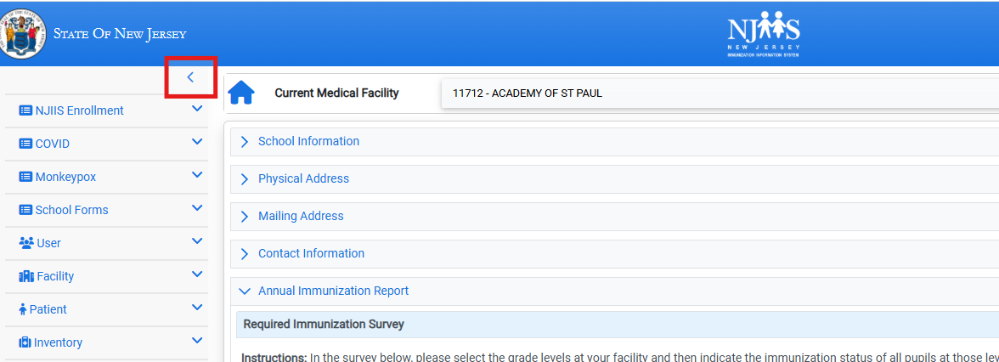

**Screenshot interpretation — image5.png:** The Chrome browser right-click/context menu appears over the NJIIS page. It includes a `Print...` menu item among other browser commands.

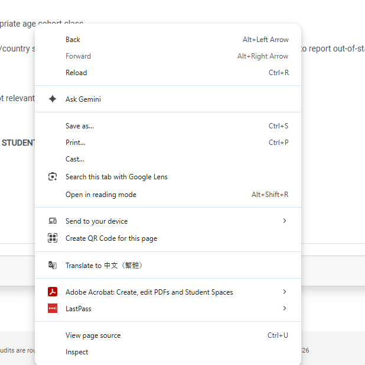

**Screenshot interpretation — image6.png:** The same context menu is shown with the `Print...` option outlined in red, identifying the exact selection to click.

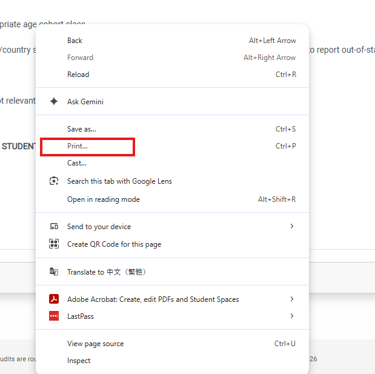

**Screenshot interpretation — image7.png:** The print dialog is open. In its right-hand panel, the `Destination` setting shows `Save as PDF`, and the bottom-right `Save` button is marked in red. The left side shows a document preview.

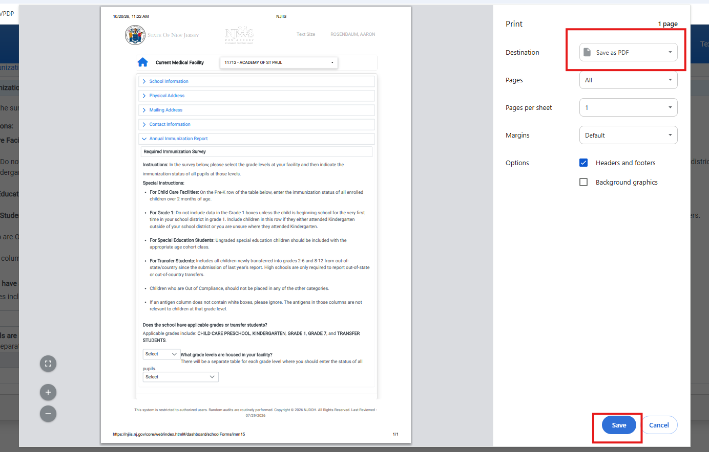

## 13. TRAINING WEBINAR: BLACK SCREEN OR AUTOMATICALLY JUMPS TO END

**Category:** Webinar technical problem  
**Source section:** `REPLY TO USERS WHO CAN ACCESS TRAINING, BUT WHO SEE A BLACK SCREEN/AUTOMATICALLY GET ROUTED TO THE END OF THE WEBINAR` (TOC page 12).  
**Trigger:** On-demand ASR training opens but shows a black screen or jumps directly to the end.

### Staff workflow (interpreted)

1. In Google Chrome, select the **three vertical dots** at the upper right.
2. Choose **Delete browsing data**.
3. Check **Cached images and files**, and choose **Delete data**.
4. Close the browser, reopen it, and attempt training again.
5. Return to the NJIIS training page and scroll to **Annual Immunization Status Report (ASR) Training**.
6. If it still fails, open the webinar registration link in a **different browser**.
7. If it also fails in a different browser, ask the sender to contact their IT staff about allowing `gotowebinar.com` using the linked GoTo webinar firewall/allowlisting guidance.

### Original SOP language

**Approved SOP wording (original text):**

```text
Hello,
I’m sorry that you’re having problems. We have received some reports from others about this issue. To troubleshoot this issue, please do the following:
Clear your cache
To clear your cache in the Google Chrome browser, click the 3 vertical dots in the upper right, and select “Delete browsing data.” Then check “Cached images and files” and click “Delete data.”
Close the browser, re-open, and attempt to access again.
Click here to access the training page and scroll down to Annual Immunization Status Report (ASR) Training.
If that doesn’t work please do the following:
Enter the webinar link https://register.gotowebinar.com/register/1147500267204169557 into a different browser.
If you run into the same problem in a different browser, we recommend contacting your IT person and asking them to whitelist this domain name: gotowebinar.com . They should also access this link for more details about whitelisting.
```

**Hyperlinks embedded behind “here” and “this link” in the source:**

- `here` (training page) → https://njiis.nj.gov/core/web/index.html
- Direct training page printed elsewhere in SOP → https://njiis.nj.gov/core/web/index.html#/home/training
- Direct webinar → https://register.gotowebinar.com/register/1147500267204169557
- `this link` (whitelisting support) → https://support.goto.com/webinar/help/allowlisting-and-firewall-configuration

**Screenshot interpretation — image8.png:** Chrome menu screenshot: the three vertical dots at the top right are circled, and `Delete browsing data...` is outlined in red in the menu. This illustrates the exact path used for the first troubleshooting step.

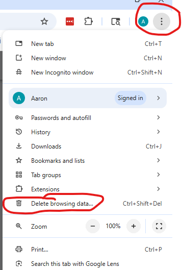

**Screenshot interpretation — image9.png:** Chrome `Delete browsing data` dialog: `Cached images and files` is checked and outlined, and the `Delete data` button is outlined in red. Other browsing data options appear but the SOP specifically directs the user to cached images/files.

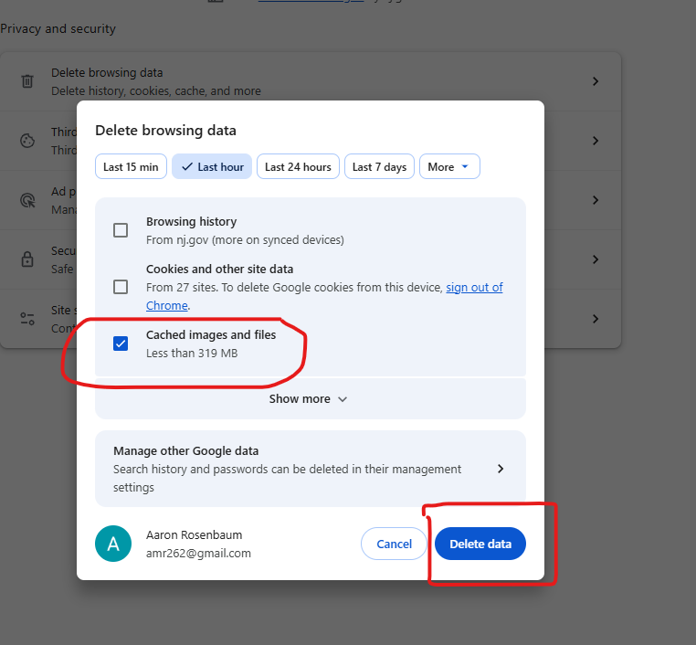

## 14. CREATED NEW ACCOUNT

**Category:** Confirmation after account creation  
**Source section:** `MISC QUESTIONS` → `CREATED NEW ACCOUNT` (TOC page 14).  
**Trigger:** An authorized staff member has already completed new NJIIS account creation.

### Staff workflow (interpreted)

1. Confirm that the user account was actually created.
2. Then tell the sender to expect an email from NJIIS asking them to create a password.
3. Share the linked ASR/Audit user guide.
4. Invite follow-up for questions.

**Important:** The SOP supplies a **confirmation message**, not the administrator steps for creating an account.

### Original SOP language

**Approved SOP wording (original text):**

```text
I have created your user account. You should receive an email from NJIIS requesting to create a password.
We have created a user guide to help through the form. You can view it here. If you have any questions and you are not able to find them in the user guide, please do not hesitate to email me.
Please let me know if you have any questions.
Thank you,
```

**Extracted user guide hyperlink behind “here”:** https://njiis.nj.gov/docs/schoolForms/ASRandAuditUserGuide.pdf

## 15. CREATE NEW USER

**Category:** New user information collection  
**Source section:** `MISC QUESTIONS` → `CREATE NEW USER` (TOC page 15).  
**Trigger:** Staff need information to prepare a new user account.

### Staff workflow (interpreted)

1. Request the six fields exactly as shown below.
2. Check the response for missing details.
3. The SOP does not show the account-creation UI steps. Use applicable authorized procedures outside this document for the actual account creation.

### Original SOP language

**Approved SOP wording (original text):**

```text
I can create an account for you. Please provide me with the following information to create your account:
First Name:
Last Name:
Email:
Work Phone:
Name of the school:
Date of ASR training:
```

## 16. CONFIRMING RECEIPT OF DATA

**Category:** ASR/Audit grade submission verification  
**Source section:** `MISC QUESTIONS` → `CONFIRMING RECEIPT OF DATA` (TOC page 16 onward).  
**Trigger:** A school asks whether the department received ASR data for particular grade levels.

### Administrative verification procedure (from source text and screenshots)

1. Enter the **facility ID** in the **Current Facility** search field.
2. Select the correct facility from the search results.
3. In the left-hand navigation, expand **School Forms**, then select **LHD Imm. Audit Report**.
4. In the report view, select the **Edit** icon (pencil symbol) shown for the relevant report.
5. Click the `+` expand buttons next to **Grade** and **Annual Immunization Status Report**, where present, to inspect the grade-level information.
6. Record the **actual grades for which data are visible**; do not infer a submission for a grade just because a different grade appears.
7. Choose the response for **data found** or **data not found** after staff verification.

### Original SOP administrative checklist

**Source admin instructions (original text):**

```text
STEPS FOR ADMIN STAFF TO CHECK FOR DATA SUBMISSION
Enter facility ID in Current Facility search field
Select the facility
Click School Forms menu and select LHD Imm. Audit Report
Click Edit icon
Click + buttons next to Grade and Annual Immunization Status Report when you see them
```

**Screenshot interpretation — image11.png:** The `Current Facility` search popup is open; an example **Facility Id** has been entered, and `Search`, `Reset`, `Close` controls are visible. This identifies where staff enter the facility ID, not which ID to use for real tickets.

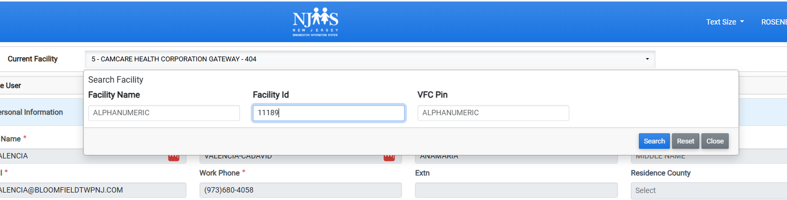

**Screenshot interpretation — image12.png:** The facility-search result row is displayed beneath the search fields. A small selection box/selector is outlined in red; selecting the matching row chooses that facility.

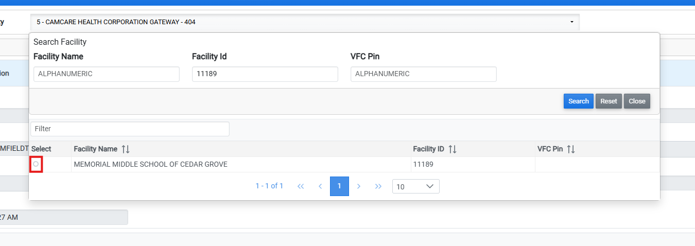

**Screenshot interpretation — image13.png:** The NJIIS left navigation is expanded at `School Forms`. It shows both `Annual Imm. Status Report` and `LHD Imm. Audit Report`; the Audit option is highlighted in red.

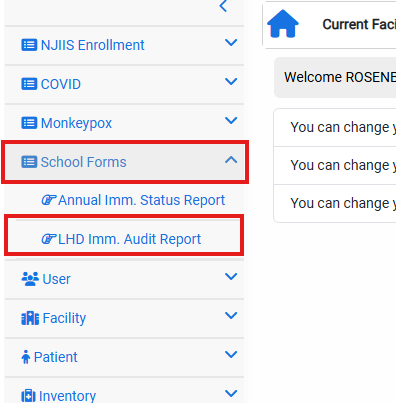

**Screenshot interpretation — image14.png:** An Audit report listing is displayed with a pencil/edit icon outlined in red on the right side of the row; this is the control the SOP says to click.

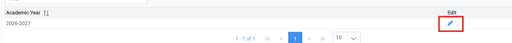

**Screenshot interpretation — image15.png:** The screenshot shows `Transfer Students` and `Annual Immunization Status Report` sections with controls outlined in red at the far right. Both controls show a **minus sign** because the pictured panels are already expanded; the written SOP instructs staff to click **plus** controls when panels are collapsed. `Overall Coverage` appears below.

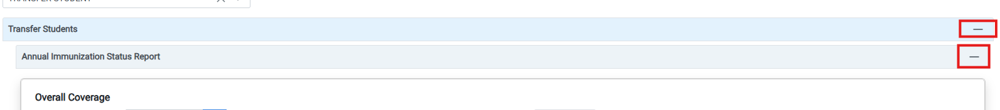

### 16A. Data **found**: approved reply

**When to use:** The specified grade-level data are actually visible in NJIIS. Replace `[LIST GRADES HERE]` with the grades verified in the system.

**Original SOP language:**

**Approved SOP wording (original text):**

```text
If data are found, send the email below and indicate what grades were found.
Hello,
I can confirm that we received the data for the following grades:
[LIST GRADES HERE]
If you entered data for other grades, that you don’t see in the list above, it is likely because the Submit button wasn’t clicked for the grade(s). Note that Each Grade has a Separate Form and Needs to be Submitted Individually
Clicking Submit on one grade’s form only submits the information for that specific grade. It will not submit the information for another grade’s form.
For example:
If you have Childcare/Preschool and Kindergarten in your school…
You need to click “Submit” at the bottom of the Pre-K/Child Care form after completing it.
You ALSO need to click “Submit” at the bottom of the Kindergarten form to submit that one.
If you click “Submit” on Pre-K/Child Care but do not click “Submit” on Kindergarten, only Pre-K/Child Care will be submitted
When you click the “Submit” button and see a popup saying that you have successfully updated your form, that means your form has been submitted for that specific grade.
```

### 16B. Data **not found**: approved reply

**When to use:** After the documented lookup, staff did not find the expected submission.

**Original SOP language:**

**Approved SOP wording (original text):**

```text
If data are NOT found, send the email below and indicate what grades were found.
Hello,
It appears that the data have not been successfully submitted.
Note that Each Grade has a Separate Form and Needs to be Submitted Individually
Clicking Submit on one grade’s form only submits the information for that specific grade. It will not submit the information for another grade’s form.
For example:
If you have Childcare/Preschool and Kindergarten in your school…
You need to click “Submit” at the bottom of the Pre-K/Child Care form after completing it.
You ALSO need to click “Submit” at the bottom of the Kindergarten form to submit that one.
If you click “Submit” on Pre-K/Child Care but do not click “Submit” on Kindergarten, only Pre-K/Child Care will be submitted
When you click the “Submit” button and see a popup saying that you have successfully updated your form, that means your form has been submitted for that specific grade.
```

### Submission interpretation and grade example

The SOP makes these points:

- **Each grade has a separate form, and each needs a separate Submit action.**
- Clicking `Submit` on a Pre-K/Child Care form does **not** submit Kindergarten automatically.
- Likewise, submitting Kindergarten does not submit Pre-K/Child Care.
- A successful-update popup confirms submission **for that specific grade**, not necessarily every grade in the school.
- A school that reported submitting many grades may have successfully submitted only some of them.

**Screenshot interpretation — image16.png:** The form's bottom-row actions include `Cancel`, `Reset`, and the blue `Submit` button, with `Submit` highlighted in red. This is the grade-specific submission control.

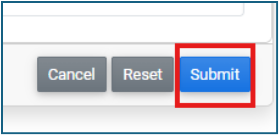

**Screenshot interpretation — image17.png:** A green confirmation popup labeled `Success` states that the school form was updated successfully. The SOP treats this as confirmation for the grade just submitted, **not** for every grade in the facility.

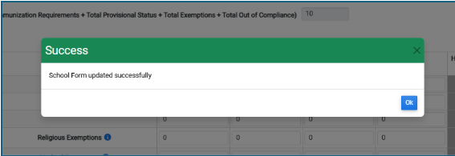

The original document reuses these two screenshots in both the data-found and data-not-found explanation; they are stored once in this package.

## Source link inventory

The following URLs were directly printed in the SOP or recovered from hyperlinks embedded behind words such as `here`.

| Resource | URL | Location in SOP |
|---|---|---|
| NJIIS school enrollment | https://njiis.nj.gov/core/web/index.html#/home/newEnrollment | School enrollment; full process |
| NJIIS school report FAQ | https://njiis.nj.gov/docs/schoolForms/NJIISSchoolReportFAQs.pdf | School enrollment |
| NJIIS training opportunities | https://njiis.nj.gov/core/web/index.html#/home/training | ASR training; LHD training; new user + training |
| Direct ASR webinar registration | https://register.gotowebinar.com/register/1147500267204169557 | Full process; training technical issues |
| ASR/Audit user guide | https://njiis.nj.gov/docs/schoolForms/ASRandAuditUserGuide.pdf | LHD access denied; linking guide; created account |
| NJIIS core website | https://njiis.nj.gov/core/web/index.html | Linked from training technical issue and several display links |
| GoToWebinar allowlisting / firewall | https://support.goto.com/webinar/help/allowlisting-and-firewall-configuration | Training technical issues |

**Link note:** These are **extracted from the DOCX**, not independently checked for current accessibility. Some visible URLs contain `#` fragments and their underlying Word hyperlinks point to a shorter base URL. Both the visible full URL and the distinct actual hyperlink destinations have been represented rather than silently replacing one with the other.

## SOP limitations, ambiguities, and review flags

This section is a faithful record of items requiring staff judgment; it is **not a replacement policy**.

1. **Email completion vs. folder movement:** The answering-emails section mentions marking complete after contact, returning to the shared Inbox, and moving to `Completed`, without precisely defining how the latter two actions interact. Do not equate Outlook's check mark with proven case resolution.
2. **Administrator actions not documented:** This SOP does not contain screen-by-screen NJIIS instructions for creating accounts, modifying a school's subtype, activating permissions, or assigning a school to a user. It provides messages telling users when those actions have happened.
3. **Account activation language:** The ASR and LHD training sections say activation can take “a couple of days”; the LHD training message additionally says to follow up after **2 business days** without a new-privileges confirmation.
4. **School enrollment contact/user wording:** The enrollment section says to add account information **as a user**; the full-process summary says **as contacts or users**. They are reproduced separately.
5. **Time-sensitive deadline:** The full-process summary explicitly lists **December 1, 2026, 11:59 PM**. This date belongs to the supplied SOP and should not be assumed applicable in future reporting seasons.
6. **User guide page number:** The LHD access-denied section refers to **page 22** of an external guide. That external guide was not provided for this extraction, so page 22 has not been independently validated.
7. **No-data response heading:** The original says “If data are NOT found, send the email below and indicate what grades were found.” That wording is internally inconsistent; it has not been silently changed in the original-text extraction.
8. **Screenshots contain sample records:** Facility names/IDs and account details in screenshots are demonstrations, not ticket-specific values. Staff must use the real facility ID from the ticket and verify results.
9. **Screens can change:** Names, labels, and screenshot navigation reflect the version captured in the original SOP. No external verification of the current NJIIS UI was performed.
10. **Missing steps/edge cases:** Where the SOP lacks a documented recovery path for an unsuccessful administrative action, the correct extraction is “not specified in source,” not a guessed procedure.

## Screenshot inventory (all unique source images)

| Image | SOP topic | Information gained from the picture |
|---|---|---|
| [image1.png](images/image1.png) | Email handling | Outlook follow-up `Mark Complete` option |
| [image2.png](images/image2.png) | Email handling | `Completed` folder in mailbox tree |
| [image3.png](images/image3.png) | School Forms tab | Left navigation module row and dropdown |
| [image4.png](images/image4.png) | Saving ASR | Left arrow to hide navigation |
| [image5.png](images/image5.png) | Saving ASR | Browser right-click context menu |
| [image6.png](images/image6.png) | Saving ASR | `Print...` command highlighted |
| [image7.png](images/image7.png) | Saving ASR | Print preview, `Save as PDF` destination, `Save` button |
| [image8.png](images/image8.png) | Training webinar | Chrome 3-dot menu and `Delete browsing data...` |
| [image9.png](images/image9.png) | Training webinar | `Cached images and files`, `Delete data` |
| [image10.png](images/image10.png) | LHD access | `Search Facility` interface and available fields |
| [image11.png](images/image11.png) | Checking submissions | Enter Facility ID in `Current Facility` search |
| [image12.png](images/image12.png) | Checking submissions | Choose matching facility result |
| [image13.png](images/image13.png) | Checking submissions | `School Forms` → `LHD Imm. Audit Report` |
| [image14.png](images/image14.png) | Checking submissions | Pencil-shaped Edit icon |
| [image15.png](images/image15.png) | Checking submissions | Expand/collapse controls for Transfer Students and ASR; screenshot shows minus signs |
| [image16.png](images/image16.png) | Grade submission | Blue `Submit` button |
| [image17.png](images/image17.png) | Grade submission | Green success popup for submitted grade |

**Packaging:** The Markdown includes complete written screenshot interpretations, so it remains usable as plain text. In the companion ZIP, the `images/` folder contains the **original embedded screenshots** referenced by the relative Markdown links above. The screenshots were not redrawn or modified.

## Copilot agent retrieval guidance (derived from the source structure)

When used as a Microsoft Copilot knowledge file:

- Match tickets by issue labels above, but use the reported symptoms and full conversation rather than the subject alone.
- Identify the correct section and distinguish confirmed facts from unverified assumptions.
- Follow written SOP instructions in the stated order; use screenshot interpretation to clarify where to click.
- Avoid repeating steps the sender already completed unless a genuine reason exists.
- Distinguish **staff actions** from **sender actions**; only authorized staff may perform administrator changes.
- Use past-tense confirmations, such as “I have updated NJIIS” or “I have created your user account,” **only after staff verify that action occurred**.
- When verifying ASR receipt, list only grades that were actually found after the documented check.
- Cite the exact SOP heading in each resolution recommendation.
- When no source-supported fix exists, say **“Not specified in SOP — needs further review.”**

