# **SOP FOR ANSWERING EMAILS**

1. Once you start correspondence with a person, please do your best to work with them through the resolution of their problem—this is to help ensure continuity and avoid people falling through the cracks.
2. Close the loop first
    1. If you’ve been working with someone, close the loop before answering other messages
    2. Once a call/email has been made (regardless of whether you’ve spoken to/interacted w/ the person), mark email as complete w/ check mark.

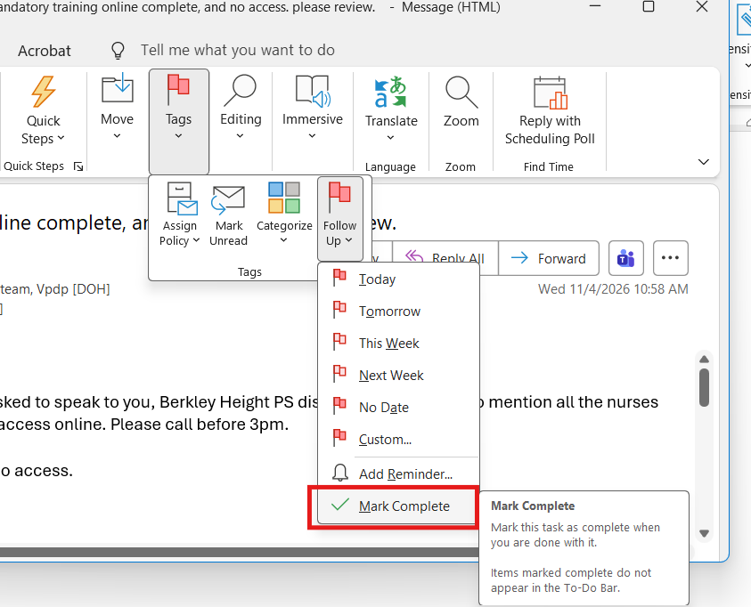

1. After closing the loop on any open user issues, answer emails that have been sitting the longest in the mailbox with the most emails
    1. Once a call/email has been made (regardless of whether you’ve spoken to/interacted w/ the person), mark email as complete w/ check mark and put the email back in the shared Inbox.
    2. Move the email to the “Completed” folder. 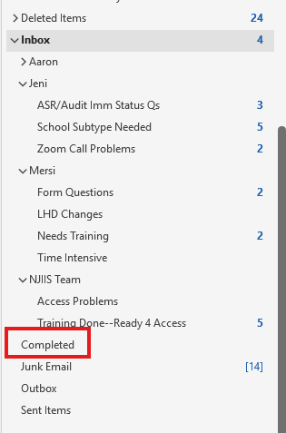

Table of Contents

[**SOP FOR ANSWERING EMAILS** 1](#_Toc245726558)

[**SCHOOL NEEDS ENROLLMENT** 3](#_Toc245726559)

[**SCHOOL SUBTYPE NEEDED** 3](#_Toc245726560)

[**SUBJECT: School Subtype Error** 3](#_Toc245726561)

[**REPLY ONCE RECEIVING SUBTYPE** 3](#_Toc245726562)

[**NEEDS TRAINING** 4](#_Toc245726563)

[**ASR TRAINING** 4](#_Toc245726564)

[**LHD TRAINING** 4](#_Toc245726565)

[**PERSON NEEDS NEW USER ACCOUNT AND TAKE THE ASR TRAINING** 5](#_Toc245726566)

[**ACCESS PROBLEMS** 6](#_Toc245726567)

[**COMPLETED TRAINING AND NEED ACCESS TO SCHOOL** 6](#_Toc245726568)

[**IF THE PERSON HAS TAKEN THE TRAINING BUT CANNOT FIND THE SCHOOL FORMS TAB** 6](#_Toc245726569)

[**LHD Emails** 7](#_Toc245726570)

[**LHDS GETTING ACCESS DENIED AT THE SCHOOL REPORT** 7](#_Toc245726571)

[**MISC QUESTIONS** 8](#_Toc245726572)

[**FULL SUMMARY OF SCHOOL ENROLLMENT & ASR TRAINING PROCESS** 8](#_Toc245726573)

[**LINKING THE USER GUIDE** 8](#_Toc245726574)

[**SAVING COPY OF ASR/AUDIT FORM** 8](#_Toc245726575)

[**REPLY TO USERS WHO CAN ACCESS TRAINING, BUT WHO SEE A BLACK SCREEN/AUTOMATICALLY GET ROUTED TO THE END OF THE WEBINAR** 12](#_Toc245726576)

[**CREATED NEW ACCOUNT** 14](#_Toc245726577)

[**LHD GET ACCESS DENIED** 14](#_Toc245726578)

[**CREATE NEW USER** 15](#_Toc245726579)

[**CONFIRMING RECEIPT OF DATA** 16](#_Toc245726580)

# **SCHOOL NEEDS ENROLLMENT**

Please enroll your school in NJIIS through here [https://njiis.nj.gov/core/web/index.html#/home/newEnrollment](https://njiis.nj.gov/core/web/index.html#/home/newEnrollment)

Please note that only information needed is those with red asterisk (\*).  Make sure to add your user account information as a user in the form so they can assign you to this school.

You can view our FAQ, which can help you complete the enrollment form, through here [https://njiis.nj.gov/docs/schoolForms/NJIISSchoolReportFAQs.pdf](https://njiis.nj.gov/docs/schoolForms/NJIISSchoolReportFAQs.pdf)

Let me know if you have further questions.

Thank you,

# **SCHOOL SUBTYPE NEEDED**

## **SUBJECT: School Subtype Error**

Hello,

It seems your school is missing the subtype. Can you let me know whether your school is Charter, Public, or Private? Once I get that info, I will update NJIIS and you should be able to complete your ASR after that point.

Thanks.

## **REPLY ONCE RECEIVING SUBTYPE**

Hi,

Thanks for the information. I have updated NJIIS. Please log back in and try again.

Please let me know if you have any other problems.

Thanks.

# **NEEDS TRAINING**

## **ASR TRAINING**

Have you completed the ASR training? Once the training is completed, please expect to wait a couple of days for your user account to be activated.

To register to the Annual Immunization Report (ASR) training, please go to the [NJIIS Training Opportunities](https://njiis.nj.gov/core/web/index.html#/home/training) ([https://njiis.nj.gov/core/web/index.html#/home/training](https://njiis.nj.gov/core/web/index.html#/home/training)), find the _NJIIS Training Access to On-Demand Webinar Recordings_ table, and enroll into the Annual Immunization Status Report (ASR) Training by clicking “View.”

This training will walk you through the new ASR.

Let me know if you have further questions.

Thank you,

## **LHD TRAINING**

Have you completed the Audit training? Once the training is completed, please expect to wait a couple of days for your user account to be activated.

To register to the Local Health Dept Immunization Audit Training, please go to the [NJIIS Training Opportunities](https://njiis.nj.gov/core/web/index.html#/home/training) ([https://njiis.nj.gov/core/web/index.html#/home/training](https://njiis.nj.gov/core/web/index.html#/home/training)), find the _NJIIS Training Access to On-Demand Webinar Recordings_ table, and enroll into the **Local Health Dept Immunization Audit Training** by clicking “View.”

This training will walk you through the new Audit form.

If you do not receive an email from me confirming the new privileges after 2 business days, please reach out to me.

Let me know if you have further questions.

Thank you,

# **PERSON NEEDS NEW USER ACCOUNT AND TAKE THE ASR TRAINING**

I can create an account for you. Please provide me with the following information to create your account:

First Name:

Last Name:

Email:

Work Phone:

Name of the school:

Date of ASR training:

Please also take the ASR Training course to activate your account. Once the training is completed, please expect to wait a couple of days for your user account to be activated.

To register to the Annual Immunization Report (ASR) training, please go to the [NJIIS Training Opportunities](https://njiis.nj.gov/core/web/index.html#/home/training) ([https://njiis.nj.gov/core/web/index.html#/home/training](https://njiis.nj.gov/core/web/index.html#/home/training)), find the _NJIIS Training Access to On-Demand Webinar Recordings_ table, and enroll into the Annual Immunization Status Report (ASR) Training by clicking “View.”

This training will walk you through the new ASR.

Let me know if you have further questions.

Thank you,

# **ACCESS PROBLEMS**

## **COMPLETED TRAINING AND NEED ACCESS TO SCHOOL**

Your account has been activated, and you should now have access to the School Forms module and ASR for SCHOOL.

If you are still having problems, please try the following:

1. Clear browser cache
2. Close browser
3. Open browser
4. Access NJIIS

## **IF THE PERSON HAS TAKEN THE TRAINING BUT CANNOT FIND THE SCHOOL FORMS TAB**

I received a message about difficulty finding the School Forms tab in your NJIIS account. The tab is located on the left side of your screen and looks like the screenshot below. Are you able to see that? Please advise. Thanks.

**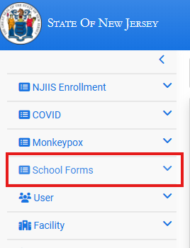**

# **LHD Emails**

## **LHDS GETTING ACCESS DENIED AT THE SCHOOL REPORT**

Please make sure to change the main facility to the school on the homepage before going to the audit form.

You can see our user guide [here](https://njiis.nj.gov/docs/schoolForms/ASRandAuditUserGuide.pdf) (Pg 22).

Please let me know if you have any questions.

Thank you,

# **MISC QUESTIONS**

## **FULL SUMMARY OF SCHOOL ENROLLMENT & ASR TRAINING PROCESS**

The reporting process has changed. The Annual Immunization Status Report (ASR) is now only available on the New Jersey Immunization Information System (NJIIS). To get access to the form, a school must enroll in NJIIS, all people who wish to view or edit the ASR should be included on the enrollment form, and those individuals must also complete the on-demand ASR training. Please see the process below to access the enrollment form and training.

Here is the process:

1. Enroll school in NJIIS using this link [https://njiis.nj.gov/core/web/index.html#/home/newEnrollment](https://njiis.nj.gov/core/web/index.html#/home/newEnrollment)
2. On the enrollment form, please include as either contacts or users anyone who you want to have access to either view or edit the Annual Immunization Status Report (ASR)
3. All people who want to view/edit the ASR must complete the on-demand ASR training, which is available here: [https://register.gotowebinar.com/register/1147500267204169557](https://register.gotowebinar.com/register/1147500267204169557)
4. Please submit the ASR by the deadline: Dec 1, 2026 at 11:59 PM

## **LINKING THE USER GUIDE**

We have created a user guide to help through the form. You can view it [here](https://njiis.nj.gov/docs/schoolForms/ASRandAuditUserGuide.pdf). If you have any questions and you are not able to find them in the user guide, please do not hesitate to email me.

Please let me know if you have any questions.

Thank you,

## **SAVING COPY OF ASR/AUDIT FORM**

1. While in your ASR form on NJIIS, do the following:
    1. Select Yes to the question “Does the school have applicable grades or transfer students?”
    2. Select the applicable grades by answering the question: “What grade levels are housed in your facility?”
    3. Open up the ASR form for each grade selected so that you see the tables w/ blank boxes for each grade.
    4. Click the left arrow at the top of the menu on the left to hide that menu.

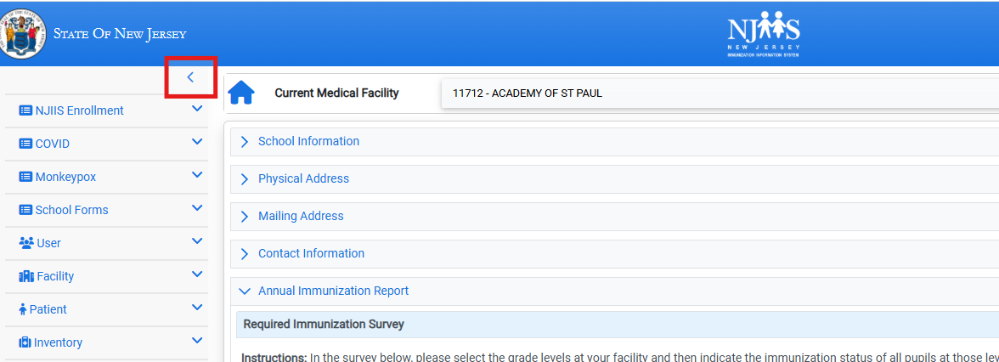

- 1.  Move your cursor to the middle of the screen, right click your mouse so that the menu shown below appears on your screen (or something similar if you’re not using Google Chrome)

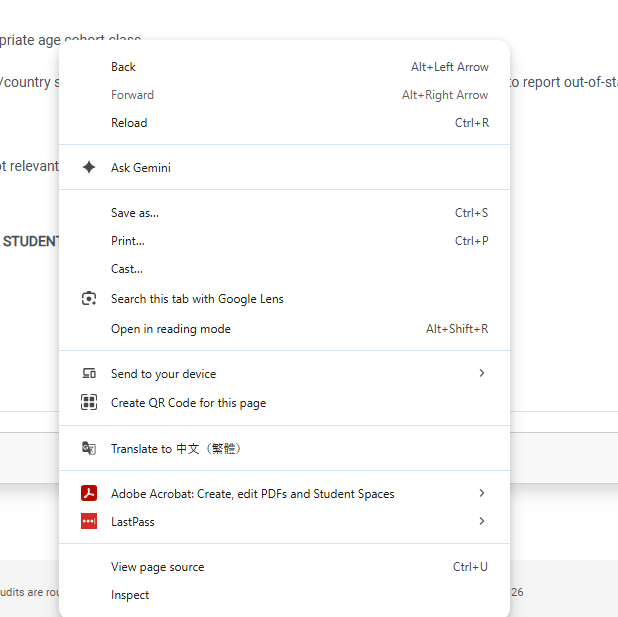

- 1.  Click “Print”

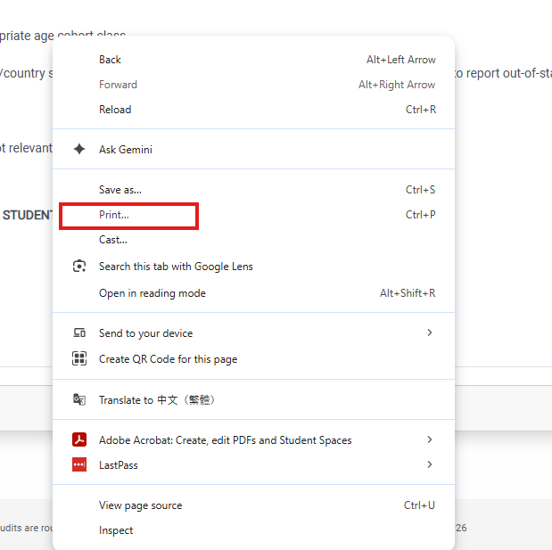

- 1.  After selecting “Print” a window will pop up.
        1. In “Destination” select “Save as PDF”
        2. Then click “Save”

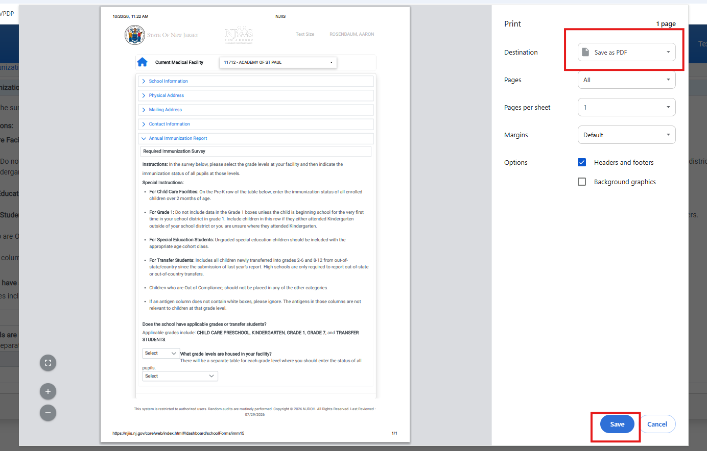

Does this give you what you need? Thanks.

## **REPLY TO USERS WHO CAN ACCESS TRAINING, BUT WHO SEE A BLACK SCREEN/AUTOMATICALLY GET ROUTED TO THE END OF THE WEBINAR**

Hello,

I’m sorry that you’re having problems. We have received some reports from others about this issue. To troubleshoot this issue, please do the following:

1. Clear your cache

- To clear your cache in the Google Chrome browser, click the 3 vertical dots in the upper right, and select “Delete browsing data.” Then check “Cached images and files” and click “Delete data.”
- Close the browser, re-open, and attempt to access again.

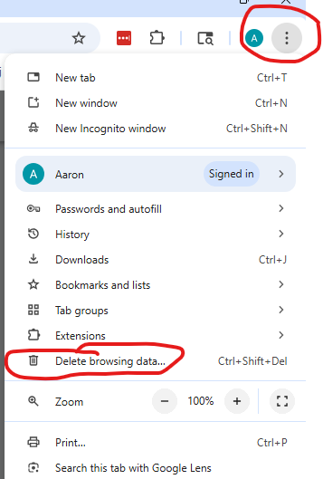

- Click [here](https://njiis.nj.gov/core/web/index.html#/home/training) to access the training page and scroll down to Annual Immunization Status Report (ASR) Training.

If that doesn’t work please do the following:

1. Enter the webinar link https://register.gotowebinar.com/register/1147500267204169557 into a different browser.
2. If you run into the same problem in a different browser, we recommend contacting your IT person and asking them to whitelist this domain name: gotowebinar.com . They should also access [this link](https://support.goto.com/webinar/help/allowlisting-and-firewall-configuration) for more details about whitelisting.

## **CREATED NEW ACCOUNT**

I have created your user account. You should receive an email from NJIIS requesting to create a password.

We have created a user guide to help through the form. You can view it [here](https://njiis.nj.gov/docs/schoolForms/ASRandAuditUserGuide.pdf). If you have any questions and you are not able to find them in the user guide, please do not hesitate to email me.

Please let me know if you have any questions.

Thank you,

## **LHD GET ACCESS DENIED**

On the dropdown, make sure to change to a school. You can see the list on the drop down.

If there are more than 20 facilities, it should show as a search:

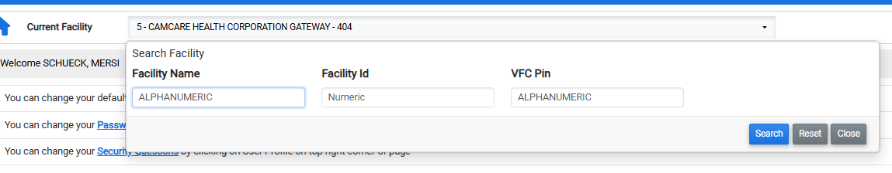

If you do get this, please let me know and I can give you the facilities in your user account so you can check that way.

Thank you,

## **CREATE NEW USER**

I can create an account for you. Please provide me with the following information to create your account:

First Name:

Last Name:

Email:

Work Phone:

Name of the school:

Date of ASR training:

## **CONFIRMING RECEIPT OF DATA**

**STEPS FOR ADMIN STAFF TO CHECK FOR DATA SUBMISSION**

1. Enter facility ID in Current Facility search field

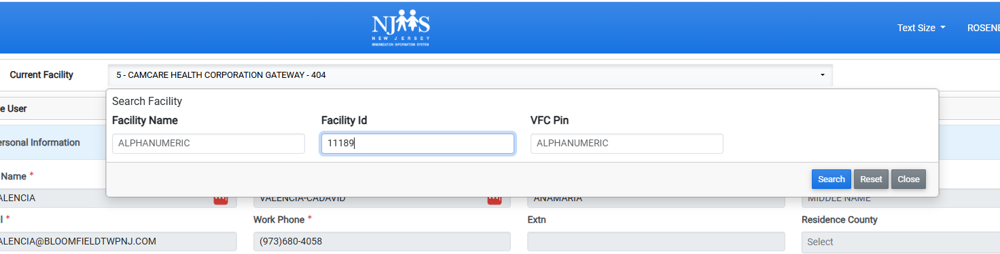

1. Select the facility

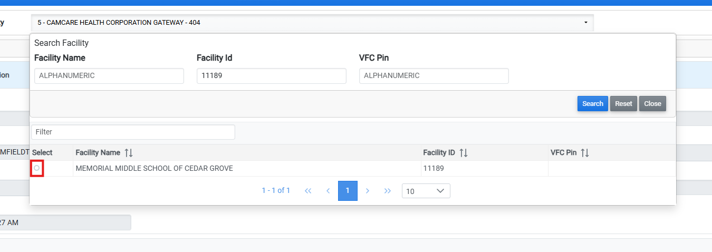

1. Click School Forms menu and select LHD Imm. Audit Report

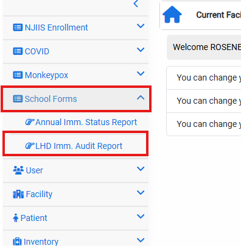

1. Click Edit icon

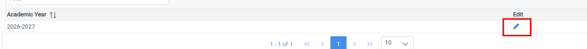

1. Click + buttons next to Grade and Annual Immunization Status Report when you see them

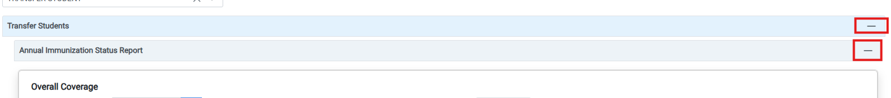

**SEND EMAIL RESPONSE**

**If data are found, send the email below and indicate what grades were found.**

Hello,

I can confirm that we received the data for the following grades:

\[LIST GRADES HERE\]

If you entered data for other grades, that you don’t see in the list above, it is likely because the Submit button wasn’t clicked for the grade(s). **Note that** **Each Grade has a Separate Form and Needs to be Submitted Individually** 

- Clicking Submit on one grade’s form only submits the information for that specific grade. It will not submit the information for another grade’s form. 
- For example: 
- If you have Childcare/Preschool and Kindergarten in your school… 
- You need to click “Submit” at the bottom of the Pre-K/Child Care form after completing it.  
- You ALSO need to click “Submit” at the bottom of the Kindergarten form to submit that one. 
- If you click “Submit” on Pre-K/Child Care but do not click “Submit” on Kindergarten, only Pre-K/Child Care will be submitted 

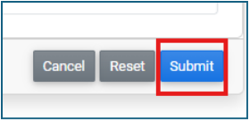 

- When you click the “Submit” button and see a popup saying that you have successfully updated your form, that means your form has been submitted _for that specific grade_. 

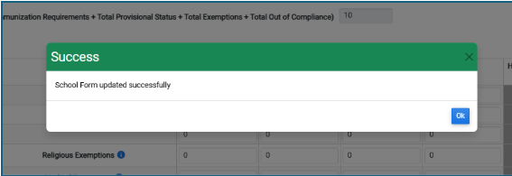

**If data are NOT found, send the email below and indicate what grades were found.**

Hello,

It appears that the data have not been successfully submitted.

**Note that** **Each Grade has a Separate Form and Needs to be Submitted Individually** 

- Clicking Submit on one grade’s form only submits the information for that specific grade. It will not submit the information for another grade’s form. 
- For example: 
- If you have Childcare/Preschool and Kindergarten in your school… 
- You need to click “Submit” at the bottom of the Pre-K/Child Care form after completing it.  
- You ALSO need to click “Submit” at the bottom of the Kindergarten form to submit that one. 
- If you click “Submit” on Pre-K/Child Care but do not click “Submit” on Kindergarten, only Pre-K/Child Care will be submitted 

- When you click the “Submit” button and see a popup saying that you have successfully updated your form, that means your form has been submitted _for that specific grade_. 

