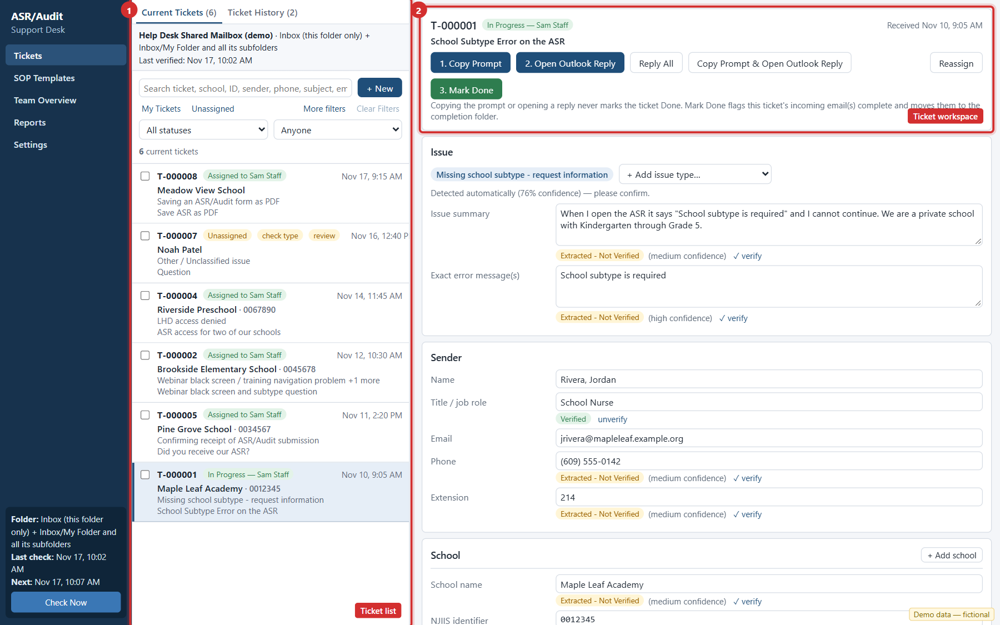
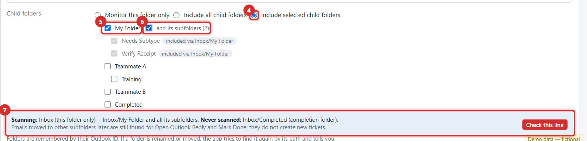
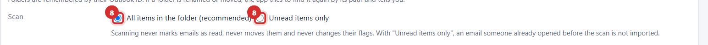
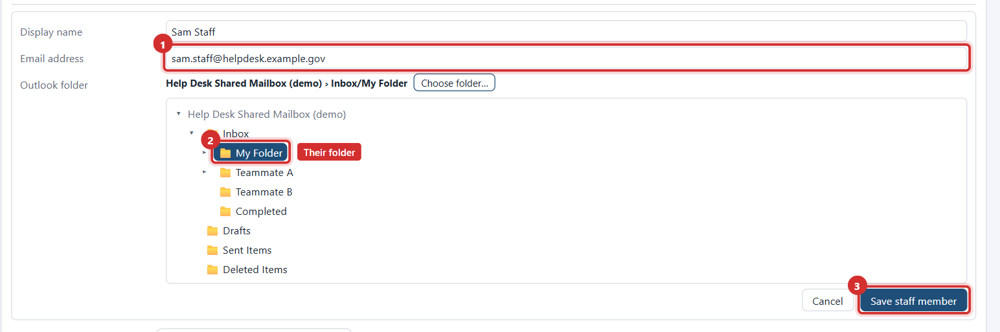
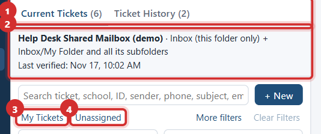
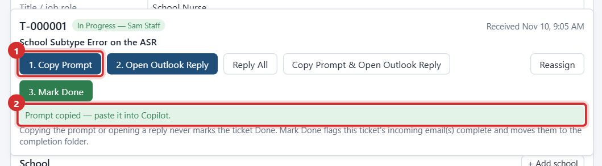

::: {.callout-note appearance="simple"}
The screenshots use made-up names, schools, and emails. Red numbers show where to click. Your screen will show your real tickets.
:::

# What You Can Do With This App {#sec-start}

The app helps you manage ASR and Audit support emails from **classic Outlook**. It turns emails into tickets, helps staff share work, and keeps a history of what happened.

You review and send school replies yourself in Outlook. The app does not send those replies.

{fig-alt="The ticket list and ticket details"}

## Install and open the app

1. Run the supplied Windows installer.
2. Open **ASR Audit Support Desk** from the Start menu.
3. Keep classic Outlook open.

Use the normal Windows account. Do not use **Run as administrator**.

{fig-alt="The app in the Windows Start menu"}

# Set up Outlook once {#sec-settings}

## Connect Outlook

1. Open **Settings**.
2. Click **Test Outlook Connection**.
3. Wait for the green success message.

{fig-alt="The Outlook connection test"}

## Choose the mailbox and folders

1. Under **Monitored Folders**, click **Find Mailboxes**.
2. Choose the shared mailbox.
3. Choose **Inbox**, or another folder used by your team.

{fig-alt="The mailbox list"}

{fig-alt="The Outlook folder tree"}

Choose one folder option:

- **Monitor this folder only** reads only the selected folder.
- **Include all child folders** reads the folder and everything inside it.
- **Include selected child folders** lets you choose only the folders you need.

When using selected folders, tick **and its subfolders** to include folders below the selected folder. Read the **Scanning:** message before saving.

{fig-alt="Child folder selection and the Scanning message"}

Choose **All items in the folder (recommended)** unless your manager says to use **Unread items only**.

{fig-alt="The scan mode choices"}

## Choose the completion folder

1. In **Completion Folder (Mark Done)**, click **Open**.
2. Choose the folder for finished emails.
3. Click **Validate**.
4. Continue when the folder shows **OK**.

{fig-alt="Completion folder selection and validation"}

The completion folder is not scanned for new tickets.

## Add staff members

1. Open **Staff Assignment**.
2. Click **+ Add staff member** or **Edit**.
3. Enter the name and email address.
4. Click **Choose folder...** and choose the person's Outlook folder.
5. Click **Save staff member**.
6. Choose your own name beside **I am**.
7. Click **Save Settings**.

{fig-alt="Staff names, email addresses, folders, and the I am setting"}

{fig-alt="The staff member form"}

# Find and review tickets {#sec-tickets}

1. Click **Tickets**.
2. Click **Check Now**.
3. Open a ticket from **Current Tickets**.

Use **My Tickets**, **Unassigned**, the search box, and **More filters** to find work. Use **Ticket History** for finished or moved tickets. Click **Clear Filters** if a ticket seems to be missing.

{fig-alt="Current Tickets, My Tickets, Unassigned, and Ticket History"}

Check the sender, school, issue, and email. Add a school with **+ Add school**. Add an issue with **+ Add issue type...**. Write work already completed under **Staff actions already taken** and other information under **Staff notes**.

# Claim, assign, and reassign {#sec-assign}

| Button | What it means |
|---|---|
| **Claim** | You take responsibility. The email does not move. |
| **Assign** | Give the ticket to a staff member. The incoming email moves to that person's folder and one handoff email is sent. |
| **Reassign** | Transfer the ticket to another staff member. The assignment history stays with the ticket. |

To claim a ticket, open it and click **Claim**. Click **Start Work** when you begin. If another person owns it, use **Take over...**. The earlier history stays on the ticket.

To assign or reassign:

1. Open the ticket and click **Assign** or **Reassign**.
2. Choose the staff member.
3. Check the email address and folder.
4. Add a handoff note if needed.
5. Click **Assign**.

{fig-alt="Assign, Reassign, and Start Work"}

{fig-alt="The assignment dialog"}

The app moves incoming school emails only. If a move fails, fix the problem and click **Retry assignment**. If the handoff email fails, click **Retry Notification**. The assignment history stays in the ticket.

{fig-alt="The assignment result"}

# Write and send the reply {#sec-reply}

1. Click **Copy Prompt**.
2. Paste it into Microsoft Copilot.
3. Read Copilot's draft. Check names, school IDs, dates, and completed actions.
4. Copy the reply.
5. Click **Open Outlook Reply** or **Reply All**.
6. Paste the reply into Outlook and click **Send**.

{fig-alt="Copy Prompt"}

{fig-alt="Open Outlook Reply"}

# Mark a ticket Done {#sec-done}

After sending the reply in Outlook, return to the ticket and click **Mark Done**. The app records the decision and keeps the ticket history. If the app reports a problem, fix the problem and click **Retry Mark Done**. Open a finished ticket from **Ticket History** and click **Reopen** to work on it again.

{fig-alt="Mark Done on a ticket"}

# Shared ticket records {#sec-shared}

The shared records file lets staff see the same tickets, owners, notes, statuses, and history. The default file is:

`\\epi-qb-5\VPD_Shared\PgmDocs\Assessment and Coverage\Annual Immunization Status Report\ASR Master List Revamp--2023\asr_email_support.accdb`

Open **Settings > Shared Database** to see the connection status. Use **Test Connection** to check it. The same check is called **Test Database Connection** on **Diagnostics**. If the file is unavailable, the app may save changes locally and show that they are waiting to be shared. When the connection returns, use **Sync Now**.

If two people change the same ticket, open **Conflicts** and choose **Keep shared value** or **Use my value**.

# Team tools {#sec-team}

Use the left menu to open **Kanban**, **Team Overview**, **Conflicts**, **Reports**, **SOP Templates**, or **Diagnostics**.

- **Kanban** groups tickets by status. Filters and drag-and-drop use the same checks as the ticket buttons.
- **Team Overview** shows workload, older tickets, pending Outlook work, conflicts, and staff activity.
- **Related cases** shows possible matches. Link or combine only after reviewing the details.
- **Diagnostics** lets you test Outlook and the shared file and copy a problem log.

{fig-alt="Team Overview with staff workload"}

# Common Problems and How to Fix Them {#sec-help}

| Problem | What to do |
|---|---|
| Outlook cannot connect | Open classic Outlook and restart the app normally. |
| A folder is missing | Check the folder mode in Settings and click **Check Now**. |
| The shared file cannot be opened | Check the network and your permission. Use **Test Database Connection**. |
| A ticket is missing | Check **Ticket History**, clear filters, and click **Check Now**. |
| Assignment failed | Fix the message shown and click **Retry assignment**. |
| Mark Done failed | Fix the message shown and click **Retry Mark Done**. |
| Two people changed a ticket | Open **Conflicts** and choose the correct value. |

To send a problem report:

1. Open **Diagnostics**.
2. Select the problem event.
3. Click **Copy Log** or **Export Log to File...**.
4. Send the copied text or exported file to the developer.

# How to Test the App {#sec-uat}

Use test emails only. Do not move, flag, or send real Outlook messages.

| What to do | What should happen | Result |
|---|---|---|
| Test Outlook | A success message appears | Pass / Fail |
| Click **Check Now** | A test email becomes a ticket | Pass / Fail |
| Click **Claim** | You become the owner and Outlook does not change | Pass / Fail |
| Assign to Aaron | The email moves to Aaron's test folder and one handoff email is sent | Pass / Fail |
| Open a second app instance | The other user sees the ticket and owner | Pass / Fail |
| Add a note | The note is shared | Pass / Fail |
| Mark Done | The ticket appears in **Ticket History** | Pass / Fail |
| Reopen the ticket | The ticket can be worked on again | Pass / Fail |
| Disconnect and reconnect the test shared file | Local changes become shared after **Sync Now** | Pass / Fail |
| Copy a Diagnostics log | A developer can read the problem report | Pass / Fail |

For developer setup and two-instance testing, see `docs/UAT_CHECKLIST.md` and `docs/MULTIUSER_TESTING.md`.
